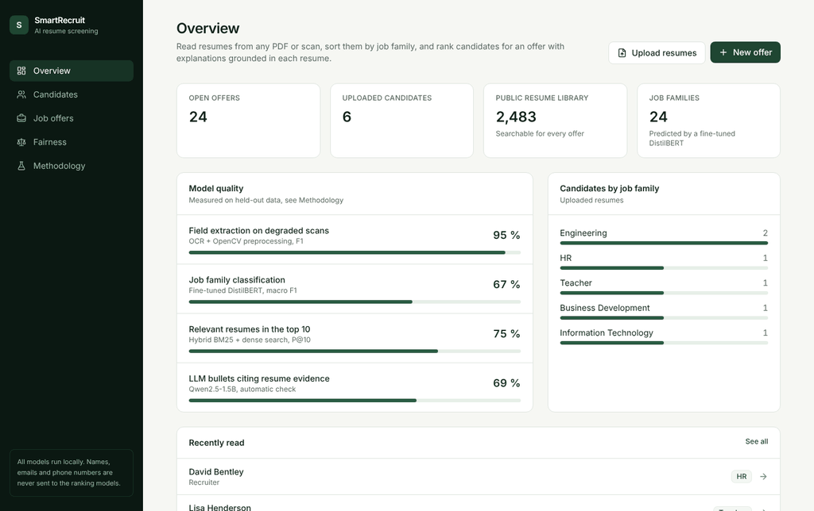
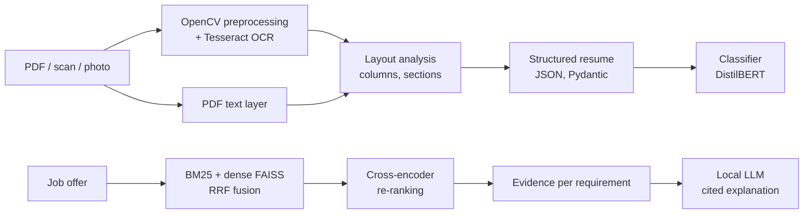
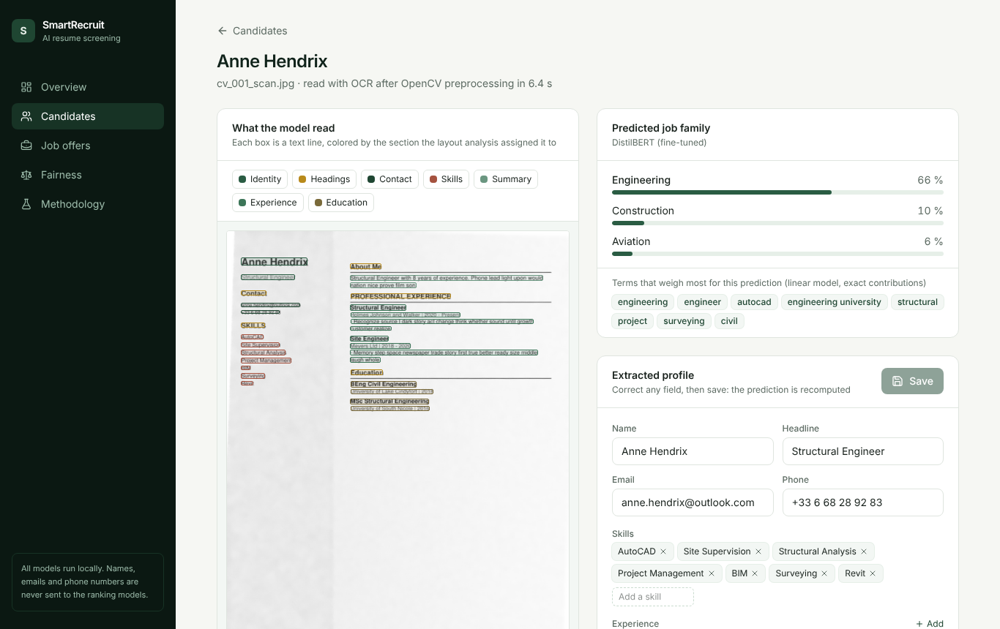
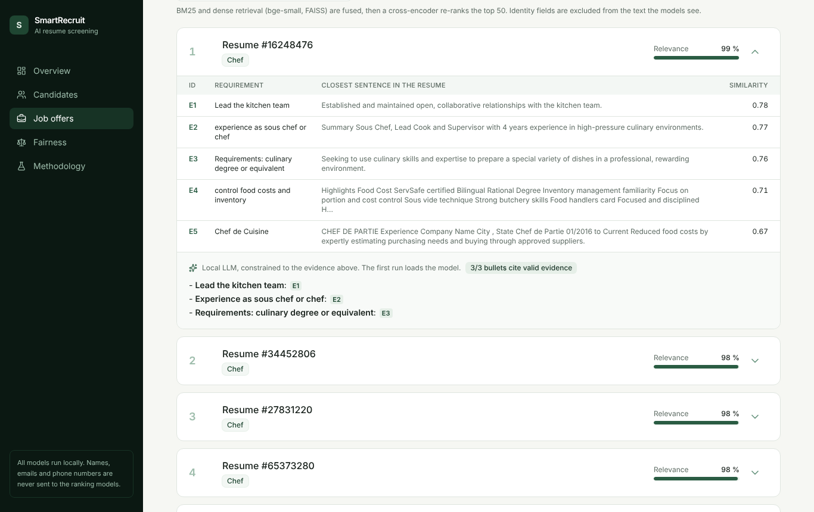
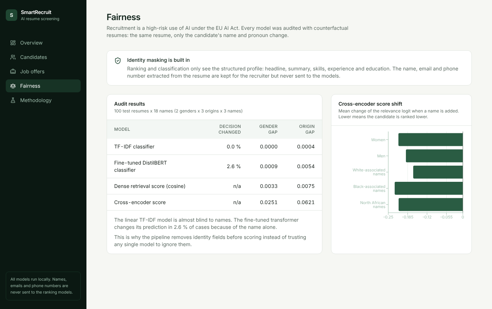
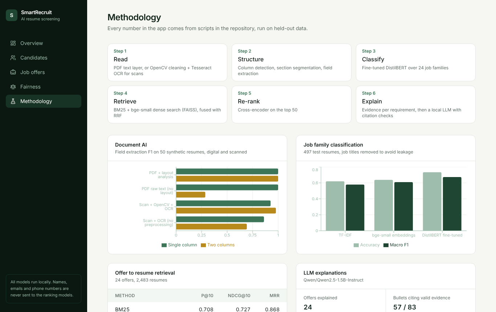
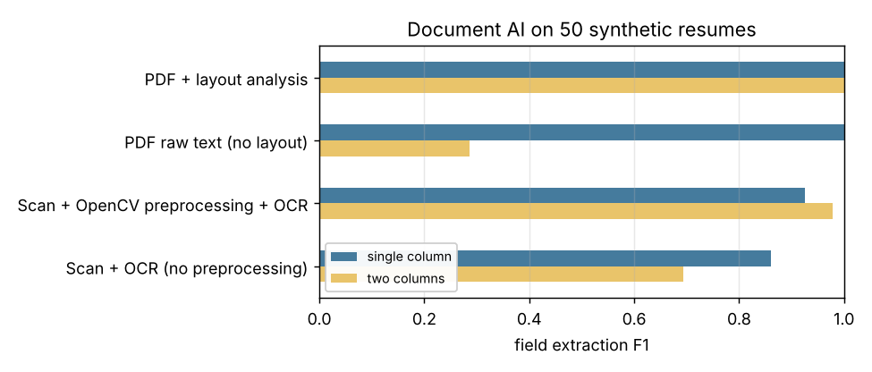
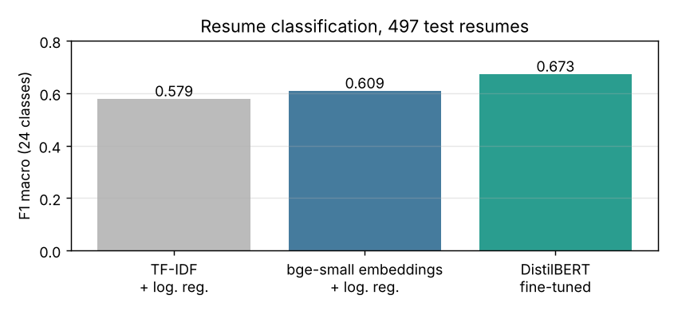

# SmartRecruit

An end-to-end AI system for resume screening:
- **document AI** (OCR and layout analysis) reads scanned or digital resumes;
- an **NLP classifier** (fine-tuned transformer) sorts them into job families;
- **semantic search with re-ranking** finds the best candidates for a job offer;
- a **local LLM** explains each match using evidence extracted from the resume;
- a **counterfactual bias audit** checks whether names change the results.

Everything runs locally and is measured. It ships as a **full-stack web application** (React + TypeScript frontend, FastAPI backend).



| Module | Techniques | Result |
| --- | --- | --- |
| Document AI | Tesseract OCR, OpenCV (illumination correction, deskew, denoising), column detection, section segmentation | Field F1 **0.95** on degraded scans (0.78 without preprocessing); **1.00** on PDFs with layout analysis (0.29 on two-column PDFs without it) |
| Classification (24 job families) | TF-IDF + logistic regression, then sentence embeddings, then **DistilBERT fine-tuned in PyTorch** | F1 macro **0.579 → 0.609 → 0.673** |
| Offer → resume search | BM25, dense retrieval (bge-small + FAISS), hybrid fusion (RRF), cross-encoder re-ranking | P@10 **0.75** (hybrid), MRR **0.92** (re-ranked) |
| Explanations (RAG) | Extractive evidence per requirement + local Qwen2.5-1.5B-Instruct, with automatic citation checking | **69 %** of bullets cite valid evidence, 14 s per explanation on CPU |
| Responsible AI | Counterfactual audit: same resume, 18 names (2 genders × 3 origins) | DistilBERT changes its decision in **2.6 %** of cases on the name alone |



## The web application

| | |
| --- | --- |
|  |  |
| **Candidate view.** The page as the OCR saw it, with every text line boxed and colored by the section the layout analysis assigned it to. The extracted profile is editable, and saving it re-runs the classifier. | **Offer view.** Candidates ranked from your uploads or the public library. Each requirement of the offer is paired with evidence from the resume. The LLM explanation streams token by token and is checked for valid citations. |
|  |  |
| **Fairness.** Results of the bias audit, and identity masking: names and contact details never reach the models. | **Methodology.** Every benchmark of this README, with interactive charts. |

| Layer | Stack |
| --- | --- |
| Frontend | React 19, TypeScript, Vite, Tailwind CSS, TanStack Query, React Router, Recharts |
| Backend | FastAPI: REST API with Pydantic validation, background processing of uploads, LLM streaming with server-sent events, SQLite storage |
| ML | PyTorch, Hugging Face Transformers, sentence-transformers, FAISS, scikit-learn, OpenCV, Tesseract |
| Delivery | Multi-stage Docker build (Node, then Python). FastAPI serves the built frontend, so one container runs everything |

---

## 1. Document AI: reading resumes

Benchmark: 50 synthetic resumes with known ground truth, in a single-column and a two-column layout. Each one exists as a digital PDF and as a simulated scan:
- rotation of ±3°;
- uneven lighting;
- blur and noise;
- JPEG compression at quality 35-60.

The same extraction rules are applied after four different reading pipelines. Scores are micro-F1 over 8 fields: name, email, phone, skills, job titles, companies, degrees and schools.

| Pipeline | Overall F1 | Single column | Two columns |
| --- | --- | --- | --- |
| **PDF + layout analysis** | **1.000** | 1.000 | 1.000 |
| PDF raw text (no layout) | 0.699 | 1.000 | 0.286 |
| **Scan + OpenCV preprocessing + OCR** | **0.953** | 0.926 | 0.978 |
| Scan + OCR (no preprocessing) | 0.781 | 0.861 | 0.693 |



- **Layout analysis matters.** Without column detection, the raw text of a two-column resume mixes the sidebar with the main column, and extraction drops to 0.29.
- **Image preprocessing matters.** On scans, it raises F1 from 0.78 to 0.95. The steps are:
  - background division for uneven lighting;
  - deskew by maximizing the variance of the projection profile;
  - non-local means denoising;
  - 2× upscaling.
- The remaining errors are typical OCR confusions (`l` → `i` in emails).
- **Limitation:** the resumes are synthetic, so the absolute scores are optimistic. What the benchmark shows is the *gap* between pipelines.

## 2. Classifying resumes into job families

Data: [public resume dataset](https://huggingface.co/datasets/Divyaamith/Kaggle-Resume) (2,483 resumes scraped from livecareer.com, 24 categories). The split is 80/20 stratified, giving 497 test resumes.

The first line of each resume is its job title (for example "HR MANAGER"), which often names the category. **It is removed**, so the models learn from the content rather than the title.

| Model | Accuracy | F1 macro | Training | Inference / resume |
| --- | --- | --- | --- | --- |
| TF-IDF (1-2 grams) + logistic regression | 0.620 | 0.579 | 12 s | 0.9 ms |
| bge-small-en-v1.5 embeddings + logistic regression | 0.638 | 0.609 | 4.7 min* | 141 ms |
| **DistilBERT fine-tuned (PyTorch, 4 epochs, 256 tokens)** | **0.732** | **0.673** | 56 min (CPU) | 114 ms |

<sub>* Embedding computation on CPU. Times measured on a 2-core CPU, without a GPU.</sub>



The hardest classes are those whose resumes are generic or overlap with other categories:
- BPO, which has only 22 resumes;
- Consultant;
- Apparel;
- Advocate.

The TF-IDF model is kept for **explainability**. Its per-term contributions to the predicted class (exact for a linear model) are shown in the app, and the most discriminant terms per class are in `results/top_terms.json`.

## 3. Finding candidates for a job offer

The pool contains all 2,483 resumes, searched with one offer per job family (24 offers, in `data/job_offers.json`). A resume counts as relevant if it belongs to the offer's job family.

| Method | P@10 | nDCG@10 | MRR |
| --- | --- | --- | --- |
| BM25 | 0.708 | 0.727 | 0.868 |
| Dense (bge-small + FAISS) | 0.725 | 0.745 | 0.888 |
| Hybrid (BM25 + dense, reciprocal rank fusion) | **0.750** | **0.747** | 0.830 |
| Hybrid + cross-encoder re-ranking (ms-marco-MiniLM) | 0.717 | 0.734 | **0.917** |

- The hybrid search gives the best top 10.
- The re-ranker puts a relevant resume first most often (MRR 0.92), but slightly lowers P@10. It was trained on web search queries, not on job offers. A re-ranker fine-tuned on (offer, resume) pairs is the logical next step.
- With 24 queries, differences of a few points are within noise.

## 4. LLM explanations (RAG)

A small model reading a whole resume tends to invent facts. Each explanation is therefore built in two steps:
1. **Extractive evidence.** Each requirement of the offer is paired with the closest sentence of the resume (bge embeddings). This step cannot hallucinate.
2. **Generation.** A local LLM (Qwen2.5-1.5B-Instruct, bfloat16 on CPU) writes 3 bullets from that evidence only. It must end each bullet with an evidence id such as `[E2]`, and the code checks every citation.

Results on the 24 offers, explaining the top candidate of each (all answers are in `results/llm_explanations.json`):
- 21/24 top candidates belong to the right job family;
- **57/83 bullets (69 %) cite valid evidence**, and 17/24 answers are fully cited;
- 14 s per explanation on CPU.

**Limitation:** a 1.5B model sometimes infers beyond the evidence ("implies GAAP knowledge"). A larger model through Ollama (see below) follows the instructions better. The citation check is there to flag such answers.

## 5. Bias audit

Recruitment is a **high-risk use case under the EU AI Act**. The audit takes 100 test resumes and creates 18 copies of each. In each copy, only the candidate's name and pronoun change:
- 2 genders;
- 3 origins: names typical of white Americans, of Black Americans (from the Bertrand & Mullainathan design) and of North African origin;
- 3 names per group.

| Model | Decision changed | Gender gap | Origin gap |
| --- | --- | --- | --- |
| TF-IDF classifier (probability of the predicted class) | 0.0 % | 0.0000 | 0.0004 |
| DistilBERT classifier (probability of the predicted class) | **2.6 %** | 0.0009 | 0.0054 |
| Dense retrieval (cosine score shift) | n/a | 0.0033 | 0.0075 |
| Cross-encoder (score shift) | n/a | 0.0251 | **0.0621** |

- The linear model is almost blind to names.
- **The fine-tuned transformer changes its prediction in 2.6 % of cases because of the name alone.**
- The cross-encoder shows the largest gap between origins. Names associated with Black Americans lose the most score.

None of these models should rank candidates with the name visible. The pipeline should **remove identity fields before scoring**, which the structured extraction of module 1 makes easy.

---

## Run it

### With Docker (simplest)

```bash
git clone https://github.com/youri-nkouakep/smartrecruit.git && cd smartrecruit
docker compose up --build
```

Open http://localhost:8000. The first build downloads the data and the models, which takes about 10 minutes.

### Without Docker

Requirements:
- Python 3.10 or newer;
- Node.js 20 or newer;
- Tesseract OCR: on Windows the [UB Mannheim installer](https://github.com/UB-Mannheim/tesseract/wiki), on Linux `apt install tesseract-ocr`;
- about 6 GB of RAM.

```bash
python -m venv venv && source venv/bin/activate        # Windows: venv\Scripts\activate
pip install -r requirements.txt
python scripts/train_classifiers.py --only tfidf embeddings   # downloads data, about 6 min on CPU
python scripts/benchmark_docai.py                            # 50 synthetic resumes to try the app

cd web && npm install && npm run build && cd ..
uvicorn api.main:app --port 8000                             # app at http://localhost:8000, API docs at /docs
```

For frontend development, run `npm run dev` in `web/` (port 5173, API calls go through a proxy) next to `uvicorn api.main:app --reload`.

Optional steps:
- `python scripts/train_classifiers.py --only finetune` fine-tunes DistilBERT: about 1 hour on CPU, a few minutes on a GPU (Google Colab). The app uses it automatically if it exists, otherwise TF-IDF.
- `scripts/evaluate_retrieval.py`, `scripts/bias_audit.py` and `scripts/evaluate_llm.py` reproduce the tables above.
- On Windows, if Tesseract is not on the PATH, add `pytesseract.pytesseract.tesseract_cmd = r"C:\Program Files\Tesseract-OCR\tesseract.exe"`.
- For faster, better explanations, install [Ollama](https://ollama.com), run `ollama pull qwen2.5:3b`, then start the API with `SMARTRECRUIT_LLM=ollama`.

```bash
python -m pytest   # unit and API tests
```

## Structure

```text
src/smartrecruit/
├── docai/       # synth.py, preprocess.py, ocr.py, layout.py, extract.py, evaluate.py
├── nlp/         # data.py, classify.py (TF-IDF, embeddings, DistilBERT fine-tuning)
├── retrieval/   # search.py (BM25, FAISS, cross-encoder), metrics.py, explain.py (RAG + LLM)
├── fairness/    # audit.py (counterfactual names)
├── schema.py    # Pydantic resume model
└── service.py   # single entry point used by the API
api/             # FastAPI routes (main.py) and SQLite storage (store.py)
web/src/         # React + TypeScript frontend: pages/, components/, api.ts
scripts/         # benchmarks and training
results/         # every number in this README
```

## Next steps

- Compare the rule-based layout analysis with **LayoutLMv3** and **Donut** on real annotated resumes.
- Fine-tune the re-ranker on (offer, resume) pairs.
- Add significance tests and mitigation (identity masking) to the bias audit.
- Deploy a public demo with a GPU-backed LLM.

## About

Started as a master's project at Université Ibn Tofail (2026), then fully rebuilt. All personal data in the benchmarks is synthetic. The public resume dataset is downloaded at run time and not redistributed. Code under the MIT license.
